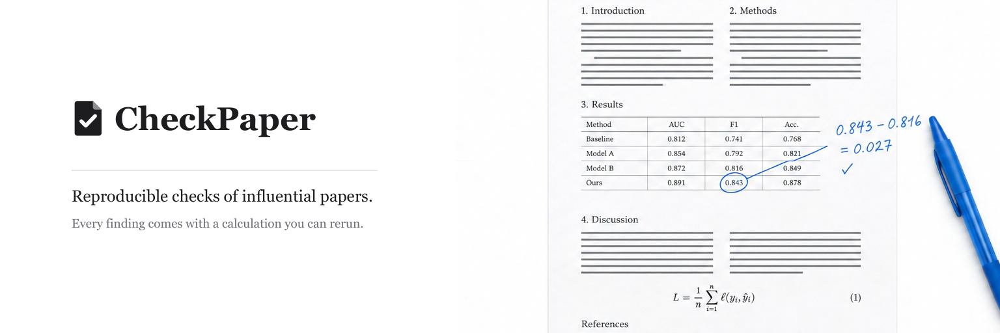

We check the papers people are reading right now, and publish only what a reader can verify with a calculator or the original text.

### What we publish

- **[Audits](https://github.com/checkpaper/audits).** Checks of trending papers, starting with Hugging Face Daily Papers. Each finding points to the exact table, figure or equation and comes with a script that recomputes it from the original PDF.
- **RetractionBench** (coming soon). Retracted papers in their original form, with the error named in the retraction notice as ground truth. A public test of whether AI reviewers catch the errors that later led to retraction.

### How we work

1. A person verifies every finding before it goes public.
2. Authors hear from us first and get 7 to 14 days to respond. Their reply is published next to the finding.
3. We report specific inconsistencies: numbers, units, tables, statistics, citations.

Check your own paper before you submit: [checkpaper.app](https://checkpaper.app)
